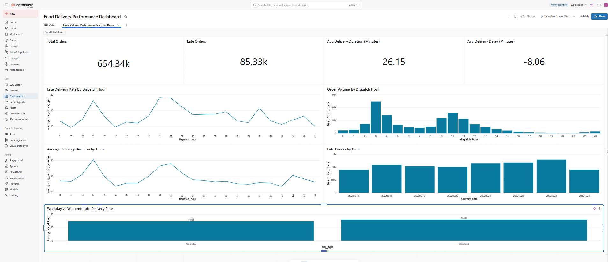

# Food Delivery Performance Analytics Pipeline

## Project Overview
An end-to-end data analytics project built using Databricks, PySpark, Delta Lake, and SQL to analyze food delivery performance, late orders, delivery duration, and operational trends.

## Objectives
- Build a Bronze–Silver–Gold data pipeline.
- Clean and transform raw delivery data using PySpark.
- Analyze on-time and late deliveries.
- Identify hourly and weekday/weekend performance trends.
- Create an interactive dashboard to visualize key performance indicators (KPIs).

## Tech Stack
- Databricks
- Apache Spark (PySpark)
- Delta Lake
- SQL
- Databricks AI/BI Dashboards
- GitHub

## Data Pipeline Architecture
**Bronze → Silver → Gold**

- **Bronze:** Stores the source delivery data.
- **Silver:** Cleans timestamp values, handles missing values, and derives delivery duration, delay, and delivery status.
- **Gold:** Contains aggregated performance metrics for analysis and dashboard reporting.

## Key Performance Indicators
- Total orders: 654,343
- Late orders: 85,328
- Average delivery duration: 26.15 minutes
- Average delivery delay: -8.06 minutes

## Key Insights
- Approximately 15.01% of deliveries with known delivery status were late.
- Weekend late-delivery rate was 15.89%, compared with 14.68% on weekdays.
- The 3 AM dataset dispatch-hour group had the highest order volume.
- The 9 AM group had the highest observed late-delivery rate at approximately 19.07%.

## Tools and Skills Demonstrated
Data engineering fundamentals, data cleaning, timestamp transformation, PySpark aggregations, SQL analytics, Delta tables, KPI development, and dashboard visualization.

## Dataset
Source: [Meituan INFORMS TSL Research Challenge](https://github.com/meituan/Meituan-INFORMS-TSL-Research-Challenge)

The dataset is used subject to its CC BY-NC 4.0 license. The original dataset is not included in this repository.

## Disclaimer
This is an analytical project based on the provided dataset. Observed relationships are descriptive and should not be interpreted as proof of causation.

## Dashboard Preview

